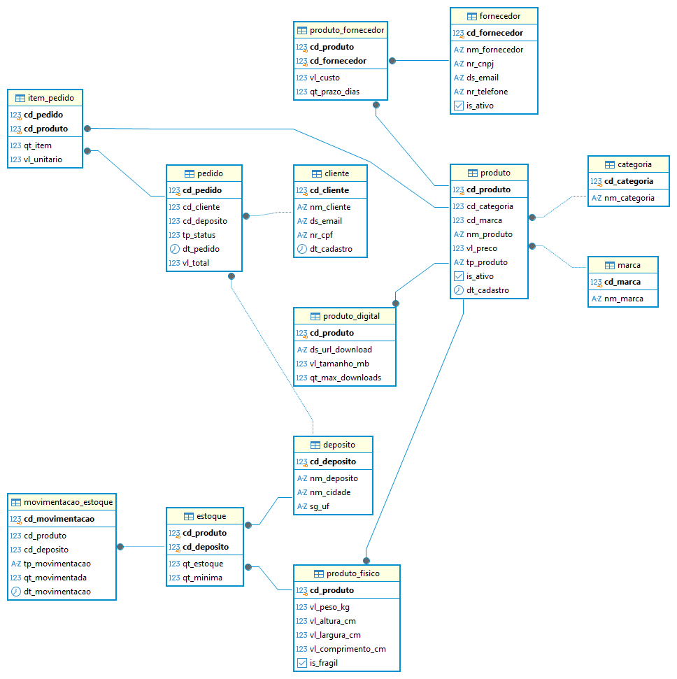
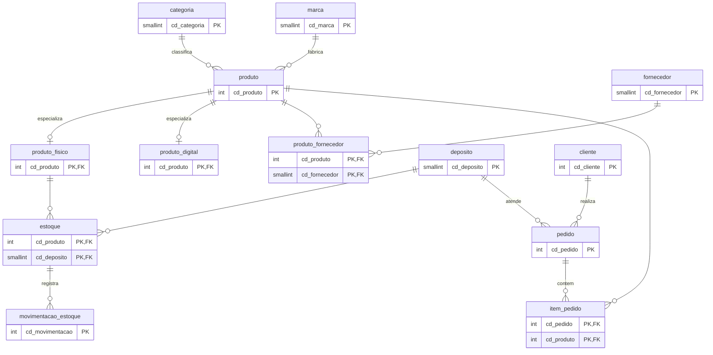

# Modelo Físico — Estoque para E-commerce (Banco de Dados II)

## Diagrama

## Normalização

- **1FN:** todos os campos são atômicos, sem grupos repetidos, e toda tabela tem PK.
- **2FN:** nas tabelas com PK composta (`produto_fornecedor`, `estoque`, `item_pedido`) cada atributo depende da chave inteira. Ex.: `qt_estoque` depende de (produto, depósito) juntos; o nome do produto fica em `produto`.
- **3FN:** sem dependências transitivas. Categoria, marca, fornecedor, cliente e depósito têm tabela própria e são referenciados por FK.

## Relações N:N

| N:N | Tabela associativa | Atributos próprios |
|---|---|---|
| produto × fornecedor | `produto_fornecedor` | vl_custo, qt_prazo_dias |
| produto × depósito | `estoque` | qt_estoque, qt_minima |
| pedido × produto | `item_pedido` | qt_item, vl_unitario |

## Tipos de dados otimizados

| Tipo | Onde | Por quê |
|---|---|---|
| `smallint` | `cd_categoria`, `cd_marca`, `cd_fornecedor`, `cd_deposito`, `qt_item`, `qt_minima`, `tp_status`, `qt_prazo_dias`, `qt_max_downloads` | poucas linhas ou valores pequenos; 2 bytes (o PostgreSQL não tem `tinyint`, então `smallint` é o menor inteiro) |
| `integer` | demais códigos e `qt_estoque` | volume maior; `bigint` seria desperdício |
| `date` | `dt_cadastro` | só interessa o dia (4 bytes) |
| `timestamp(0)` | `dt_pedido`, `dt_movimentacao` | precisa de hora, sem frações de segundo |
| `numeric(p,s)` | preços, custos, peso | precisão exata (nunca `float` para dinheiro) |
| `char(n)` | CNPJ, CPF, UF, `tp_produto`, `tp_movimentacao` | tamanho fixo |
| `boolean` | `is_ativo`, `is_fragil` | flag verdadeiro/falso |

Como o `smallint` vai até 32767, os limites de `tinyint` (0–255) ficam garantidos por `CHECK` onde importa (`qt_prazo_dias BETWEEN 0 AND 255`, `tp_status IN (1..4)`).

## As 4 constraints

- **PK:** as 13 tabelas (simples ou composta).
- **FK:** todos os relacionamentos (inclusive a FK composta de `movimentacao_estoque` para `estoque`).
- **CHECK:** preço > 0, quantidades ≥ 0, `tp_produto IN ('F','D')`, `tp_status IN (1..4)`, `tp_movimentacao IN ('E','S')`, CNPJ/CPF só dígitos (expressão regular), formato de e-mail.
- **DEFAULT:** `is_ativo = true`, datas = agora, `qt_estoque = 0`, `qt_minima = 10`, `tp_status = 1`, `vl_total = 0`.

## Objetos programáveis

- **Function** `fn_total_pedido(p_cd_pedido)`: soma `qt_item × vl_unitario` do pedido.
- **Trigger** `trg_movimentacao_atualiza_estoque` (usa a função `fn_movimentacao_atualiza_estoque`): ao inserir em `movimentacao_estoque`, soma (entrada) ou subtrai (saída) no `estoque`. Se o saldo ficar negativo, o CHECK cancela a operação.
- **Stored procedure** `sp_registrar_venda`: grava o item, dá baixa no estoque (via trigger) e recalcula `pedido.vl_total` com a function. Se algo falhar, tudo é desfeito. Exemplo: `CALL sp_registrar_venda(1, 2, 2, 2);` (pedido, produto, depósito, quantidade).

## Índices (1 por consulta de negócio)

| Consulta | Índice |
|---|---|
| Q1 produtos por categoria | `ix_produto_cd_categoria` |
| Q2 estoque baixo | `ix_estoque_qt_estoque` |
| Q3 gasto por cliente | `ix_pedido_cd_cliente` |
| Q4 mais vendidos | `ix_item_pedido_cd_produto` |
| Q5 pedidos por período/status | `ix_pedido_dt_pedido` |
| Q6 produtos de um fornecedor | `ix_produto_fornecedor_cd_fornecedor` |
| Q7 histórico de movimentação | `ix_movimentacao_produto_dt` |

Além das PKs (índice clusterizado automático) e dos `UNIQUE`.

## Quebras de normalização (justificadas)

1. **`estoque.qt_estoque`** é derivável da soma de `movimentacao_estoque`. Mantido para consultar o saldo rapidamente; o trigger garante a consistência e a movimentação segue como histórico.
2. **`pedido.vl_total`** é derivável da soma dos itens. Mantido para listar pedidos sem agregar a cada leitura; a procedure o recalcula pela function.
3. **`item_pedido.vl_unitario`** parece repetir `produto.vl_preco`, mas é o preço histórico da venda: mudar o preço hoje não pode alterar pedidos antigos. Não é quebra real de 3FN.
